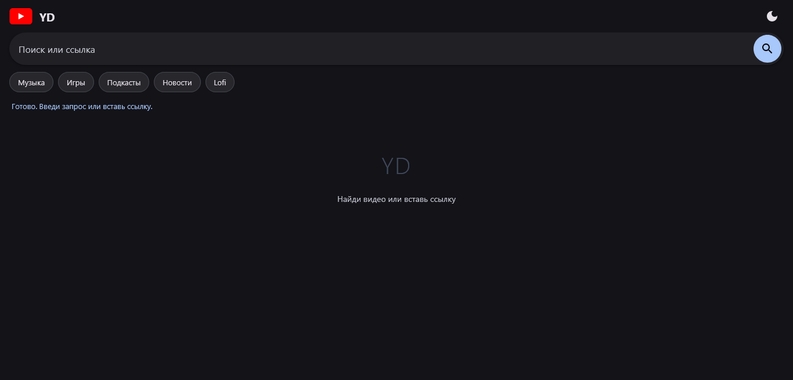

# YouDash

Лёгкий YouTube-плеер в стиле Material Design 3. Работает как PWA — открывается по ссылке и устанавливается на рабочий стол как обычное приложение.

## Что умеет

- Поиск видео (через Piped / Invidious — см. `js/api.js`)
- Воспроизведение через HTML5 `<video>` + `jmuxer` (разбор потока на стороне клиента)
- Кнопки play/pause, переключение вперёд/назад
- Прогресс-бар с перемоткой
- Выбор скорости воспроизведения (кнопка `1x`)
- Полноэкранный режим с отдельным плеером и автоповоротом в landscape
- Material Design 3, тёмная/светлая тема (переключатель в шапке)
- История просмотров и блок «похожие видео»
- Быстрые пресеты поиска
- PWA: установка на главный экран, работает без адресной строки

## Чего нет

- Скачивания видео
- Фонового воспроизведения
- Полноценного оффлайна (кэшируется только интерфейс)

## Технологии

- Чистый HTML + CSS + JavaScript, без сборщиков и фреймворков
- HTML5 `<video>` + [jmuxer](https://cdn.jsdelivr.net/npm/jmuxer@2.0.4/) (CDN) — воспроизведение потока
- Piped API и Invidious API — поиск (см. `js/api.js`)
- Service Worker + `manifest.json` — PWA и кэш интерфейса
- GitHub Pages — хостинг

## Как открыть

**Онлайн:** https://dashnew-ttokct.github.io/youdash/

**Локально:** открой `index.html` в браузере. Для корректной работы PWA и части запросов лучше поднять локальный сервер (например, `python -m http.server`), т.к. браузеры ограничивают `file://`.

> Для работы поиска и видео из РФ нужен VPN — Piped-инстансы и YouTube блокируются.

## Как установить на Android

1. Открой ссылку в Edge или Chrome.
2. Меню → «Добавить на главный экран» / «Установить приложение».
3. Иконка YouDash появится на рабочем столе.

## Структура

```
youdash/
├── index.html
├── manifest.json
├── sw.js
├── css/
│   ├── theme.css
│   ├── layout.css
│   ├── search.css
│   ├── player.css
│   ├── history.css
│   └── related.css
├── js/
│   ├── config.js
│   ├── storage.js
│   ├── theme.js
│   ├── api.js
│   ├── translate.js
│   ├── ui.js
│   ├── history.js
│   ├── related.js
│   ├── stream-player.js
│   └── main.js
└── icons/            — иконки PWA
```

> Внешняя зависимость: `jmuxer@2.0.4` подключается с jsDelivr CDN в `index.html`.

## Лицензия

MIT — делай что хочешь.
